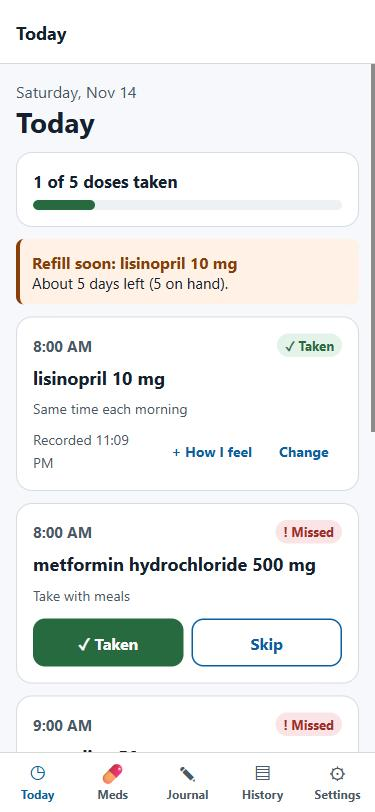
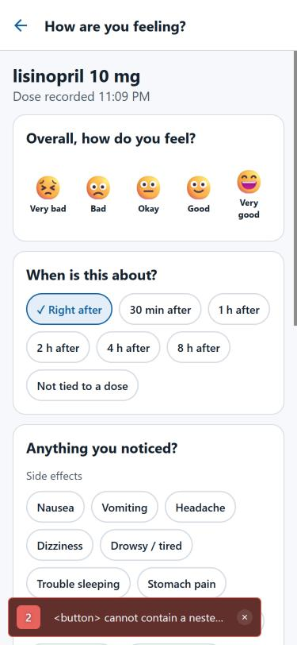
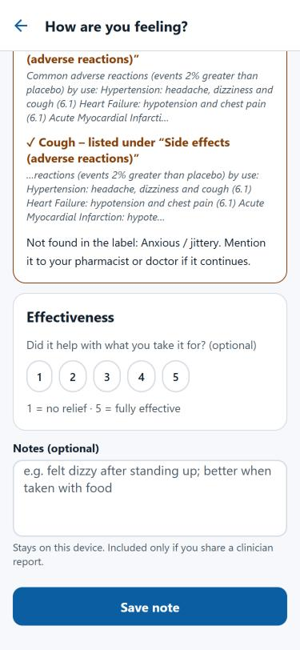
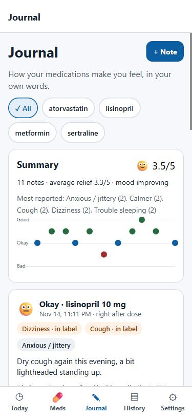

# PillPal – Medication Reminder, Effects Journal and Trusted Drug Information

COMP 4310 Web Health Informatics, Lakehead University. P4 working prototype.

PillPal is a cross-platform mobile app (React Native / Expo) that helps patients and family caregivers:

1. **add medications** from the U.S. National Library of Medicine's **RxNorm** vocabulary (standardized names + RxCUI), with manual entry as an offline fallback,
2. **get reminders** that fire on the phone even when the app is closed or offline,
3. **record each dose** as Taken / Skipped / Missed (Missed is applied automatically after a grace period),
4. **note how a medication makes them feel** after taking it (mood, side effects, relief, free text). These notes are automatically **checked against the medication's official FDA label**,
5. **review history and adherence** (7 / 30 / 90 days, per medication, daily chart),
6. **read trusted drug information** from the openFDA label, organized into clearly titled sections with the boxed warning first and saved locally for offline use, and
7. **share a summary with a clinician** (medications + adherence + journal) only when they choose.

> PillPal is an organizational and informational tool. It does not diagnose, recommend treatment, or replace a doctor or pharmacist. All demo data is synthetic.






---

## What makes it more than a reminder app

| | Generic reminder app | PillPal |
|---|---|---|
| Medication entry | Free text | RxNorm search (handles misspellings, e.g. "lipitr" → Lipitor), stores RxCUI |
| After a dose | Nothing | "How are you feeling?" journal (mood, 22 effect tags, severity, relief, timing, free text) |
| Side effects | User has to look them up | Each reported effect is matched **on-device** against the FDA label's adverse-reactions and warnings sections, with the source excerpt shown |
| Drug info | None | Official FDA label information, organized into readable sections, cached offline, and linked to DailyMed |
| Privacy | Varies | Personal schedules, dose history and journal data stay on-device. Only drug names or public identifiers are sent to RxNorm/openFDA for medication-information lookup |
| Sharing | None | A clinician summary for medication reconciliation, shared only through the OS share sheet when the user chooses |

---

## Repository layout

```text
Comp-4310-Project/
├── app/                      React Native (Expo SDK 58, TypeScript, Expo Router)
│   ├── src/app/              screens (file-based routes)
│   │   ├── (tabs)/           Today · Meds · Journal · History · Settings
│   │   ├── med/              add, edit, detail
│   │   ├── note.tsx          "How are you feeling?" effects journal entry
│   │   ├── label.tsx         official FDA label (medication information)
│   │   └── report.tsx        clinician summary
│   ├── src/core/             pure, unit-tested logic: schedules, grace period, adherence,
│   │                         refills, effects ↔ label matching, RxNorm/openFDA parsing, report
│   ├── src/data/             SQLite schema/migrations, repository, SQLCipher key setup, seed data
│   ├── src/services/         notifications (reminder engine), drug info lookups, dose use-cases
│   └── __tests__/            Jest tests (core logic + the real SQL via node:sqlite) + API fixtures
├── scripts/contrast-check.mjs  WCAG 2.1 AA colour-contrast check
└── docs/                     screenshots, test evidence, P4 report
```

There is currently no custom backend server. The application runs primarily on-device and communicates directly with the public RxNorm and openFDA APIs when medication-information lookup is required.

---

## Requirements

- **Node.js 20+** (tested on Node 26). Node 22.5+ is needed to run the data-layer tests, which use `node:sqlite`.
- For the phone: the **Expo Go** app (Android / iOS), or an Android emulator / iOS simulator.

## Setup and run

```bash
git clone https://github.com/C-Max38/Comp-4310-Project.git
cd Comp-4310-Project/app
npm install
npx expo start
```

- Scan the QR code with **Expo Go** on your phone. The phone and computer should normally be on the same Wi-Fi network, or use:

```bash
npx expo start --tunnel
```

- **Settings → Load synthetic demo data** adds a demo person with 4 real medications (real RxCUIs), 30 days of dose history and journal notes.
- `npx expo start --web` runs a browser preview.
- Reminders and encryption require a phone/native build; the remaining application functionality can be previewed on web.
- Use the web preview in **one tab only**. The browser database can only be opened by one tab at a time, so a second tab, or sometimes a hard reload, may show a blank page until the first tab is closed.

### Encrypted database (SQLCipher)

`app.json` enables SQLCipher through `expo-sqlite` using `useSQLCipher: true`.

The encryption key is a random 256-bit value stored using `expo-secure-store`, which uses protected device storage such as the iOS Keychain or Android Keystore.

**Expo Go does not include SQLCipher**, so the application runs without SQLCipher encryption when opened through Expo Go. The app reports this limitation under **Settings → Privacy & security**.

To run PillPal with SQLCipher enabled, create a development build:

```bash
cd app
npx expo run:android
```

or:

```bash
npx eas-cli@latest build --profile development
```

---

## Tests

From the repository root:

```bash
cd app
npm test
npm run typecheck
npx eslint .
```

The Jest suite covers:

- scheduling,
- grace-period logic,
- adherence calculations,
- refill logic,
- effects ↔ FDA-label matching,
- RxNorm/openFDA parsing,
- SQL repository behaviour, and
- E3 performance testing using approximately 3,800 dose records.

Run the WCAG 2.1 AA colour-contrast check from the repository root:

```bash
node scripts/contrast-check.mjs
```

Latest results are saved in [`docs/evidence/`](docs/evidence).

---

## Data sources and privacy

| Service | What PillPal sends | Why |
|---|---|---|
| RxNorm / RxNav (NLM) | Typed drug name or an RxCUI | Standardized medication search |
| openFDA drug label API | RxCUI or generic medication name | Retrieve official drug-label information |

Personal information such as medication schedules, dose history and journal notes remains in the on-device SQLite database.

Only medication names or public drug identifiers required for medication-information lookup are sent to RxNorm/openFDA.

The clinician summary leaves the application only when the user explicitly chooses to share it through the operating system's share sheet.

No API keys, credentials, or real patient information are stored in this repository.

---

## P3 requirement status (summary)

| Req | Status |
|---|---|
| FR1 add / edit / remove medications | ✅ Complete (RxNorm + manual fallback, stop-taking vs delete) |
| FR2 configurable reminder times | ✅ Complete (multiple times, days of week) |
| FR3 notifications when due | 🟡 Implemented with local notifications |
